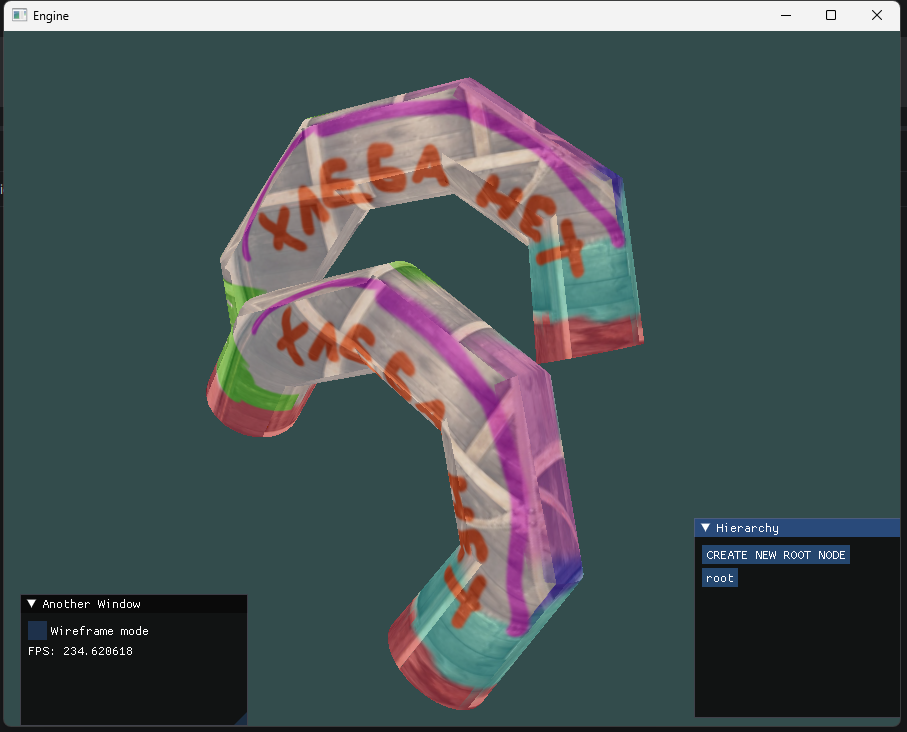

# 01.2023 - 02.2023 (dead)

# GameEngine

A small 3D game engine in C++ and OpenGL 3.3, built as a learning project from [LearnOpenGL](https://learnopengl.com/) tutorials.



## Features

- **Main loop:** `Engine` runs the loop and calls your `GameLogic` classes (`init`, `update`, `render`, `shutdown`).
- **Rendering:** wrappers for vertex arrays, vertex and index buffers, shaders and textures.
- **Meshes:** `.obj` loader.
- **Input and events:** keyboard and mouse state polling, plus input and window events you can subscribe to by category.
- **Camera:** perspective camera with position, yaw and pitch.
- **Scene nodes:** node hierarchy with local and global transforms, using a custom ref-counted `SharedPtr`.
- **Debug UI:** Dear ImGui panels, a wireframe toggle and shader reloading at runtime.

## Building

Windows only. All dependencies are included in the repo.

Build with CMake and MSVC.

```sh
cmake -S . -B build
cmake --build build --config Debug
```

Run:

```sh
cd Application
./LearnOpenGL.exe
```

## Demo controls

| Input                    | Action                             |
| ------------------------ | ---------------------------------- |
| Hold right mouse button  | Look around                        |
| `W` `A` `S` `D`          | Move                               |
| `Space` / `Left Ctrl`    | Move up / down                     |
| `Left Shift`             | Move 4x faster                     |
| `1` / `2`                | Rotate the first model around Y    |
| `3` / `4`                | Rotate the first model around X    |
| `R`                      | Reload shaders                     |
| `Esc`                    | Quit                               |

## Usage

Subclass `GameLogic` and register it with the engine. `src/ExampleGameLogic.cpp` is a complete example.

```cpp
class MyGame final : public GameLogic
{
public:
    void init() override { /* load resources */ }
    void update() override { /* read input, move things */ }
    void render() override { /* draw */ }
    void shutdown() override { /* clean up */ }
};

int main()
{
    auto& engine = Engine::get();
    engine.init("My Game", 800, 600);

    MyGame game;
    engine.addGameLogic(&game);

    engine.run();
}
```

## Project layout

```
src/
  engine/
    core/       engine loop, input, events, camera, ref counting
    render/     OpenGL wrappers and renderer
    mesh/       mesh class and .obj loader
    nodes/      scene nodes
    utils/      math, string and vector helpers
  vendor/       glad, Dear ImGui
  ExampleGameLogic.*    the demo
include/        GLFW, glad, GLM and stb headers
lib/            prebuilt GLFW
shaders/        GLSL shaders
data/           models and textures
```

## Coordinate system

Right-handed:

- Forward: -Z
- Up: +Y
- Right: +X

## Third-party libraries

- [GLFW](https://www.glfw.org/): windows and input
- [glad](https://github.com/Dav1dde/glad): OpenGL loader
- [GLM](https://github.com/g-truc/glm): math
- [Dear ImGui](https://github.com/ocornut/imgui): debug UI
- [stb_image](https://github.com/nothings/stb): image loading
